# Veritas RAG v2.0 &mdash; Enterprise Document Intelligence & Verification

[](https://www.python.org/)
[](https://fastapi.tiangolo.com/)
[](https://aistudio.google.com/)
[-000000.svg)](https://www.pinecone.io/)
[](https://aws.amazon.com/s3/)
[](https://render.com/)

**Veritas** is an enterprise-grade, multi-tenant document intelligence platform designed around trust, verifiable evidence, and strict operational safety. 

Unlike generic chatbots that guess or hallucinate answers, Veritas substantiates every response with interactive citations linked directly to verified source passages. Destructive actions (such as document deletion or policy modification) are held for administrator approval before any action is taken.

---

## Key Capabilities

* **Grounded Answers with Interactive Citations**: Every claim is linked to an exact document and page number. Clicking a citation pill opens the verified source passage in an inspection panel.
* **100% Deterministic Safety Guardrails**: Zero-latency, zero-cost input and output filters block prompt injection attacks, instruction overrides, and credential leakage without making unnecessary LLM calls.
* **Human-in-the-Loop (HITL) Safeguards**: Sensitive operations (e.g., `"delete all documents"`) are intercepted and staged in an approval queue. When approved by an administrator, an automated workflow purges vectors from Pinecone, objects from S3, and rows from PostgreSQL.
* **Multi-Tenant & Group Isolation**: Complete data separation across tenants using isolated Pinecone namespaces (`tenant-<id>`), tenant-scoped PostgreSQL queries, and group-level access control lists (ACLs).
* **Direct-to-Cloud Uploads**: Large PDF and DOCX files upload directly from the browser to AWS S3 using presigned URLs, keeping heavy binary processing off the web server.
* **Full Observability**: Comprehensive distributed tracing using GlassFlow Rius tracks latency, token usage, and graph execution across all nodes.

---

## High-Level System Architecture

The following interactive flowchart illustrates the end-to-end architecture of Veritas RAG v2.0 &mdash; including browser direct-to-S3 uploads, deterministic security guardrails, the LangGraph agent state machine, Google Gemini AI integration, multi-tier storage, and automated human-in-the-loop (HITL) purge execution:

```mermaid
flowchart TD
    %% ==========================================
    %% SUBGRAPHS / LOGICAL TIERS
    %% ==========================================

    subgraph CLIENT["Client Presentation Tier (Browser SPA)"]
        UI_CHAT["Knowledge Chat UI<br/>(Interactive Citation Viewer)"]
        UI_DOCS["Document Library<br/>(Direct S3 Upload Dropzone)"]
        UI_APPR["Approvals Desk<br/>(HITL Review & Decision Queue)"]
        UI_ADMIN["Admin Dashboard<br/>(Telemetry & Health Metrics)"]
    end

    subgraph GATEWAY["Application & Security Gateway (FastAPI)"]
        ROUTER["REST API Routing Layer<br/>(/api/chat, /api/documents, /api/approvals)"]
        AUTH_CTX["Multi-Tenant Context & ACLs<br/>(Tenant ID, User Subject, Group Memberships)"]
        GUARD_IN{"Deterministic Input Guardrail<br/>(Regex Injection & Override Check)"}
        HITL_GATE{"HITL Safety Policy Gate<br/>(Destructive Action Detection?)"}
    end

    subgraph RAG_PIPELINE["LangGraph Agentic RAG State Machine"]
        NODE_GUARD["Node: guard<br/>(Input Sanitization)"]
        NODE_RETR["Node: retrieve<br/>(Query Embedding & Vector Search)"]
        NODE_ROUTE{"Node: route<br/>(Evidence Score Threshold)"}
        NODE_GEN["Node: generate<br/>(Quarantined Prompt & Answer Synthesis)"]
        NODE_VAL["Node: validate<br/>(Output Credential & Key Leak Check)"]
        NODE_NO_EV["Node: no_evidence<br/>(Authorized Fallback Answer)"]
    end

    subgraph MODELS["AI & Model Layer (Google Gemini)"]
        GEMINI_EMBED["models/gemini-embedding-001<br/>• 1024-dim Matryoshka Truncation<br/>• Unit L2 Normalization<br/>• Task: RETRIEVAL_QUERY / DOCUMENT"]
        GEMINI_CHAT["gemini-3.8-flash<br/>• 1M Token Context Window<br/>• Low-Temperature Grounded Generation<br/>• Inline Citation Formatting [1], [2]"]
    end

    subgraph INGEST_PURGE["Background Processing & Deletion Engines"]
        WORKER_INGEST["Document Ingestion Worker (worker/ingest.py)<br/>• S3 Read & Text Extraction (PDF / DOCX)<br/>• Text Chunking (1000 char / 180 overlap)<br/>• Gemini Batch Embed & Pinecone Upsert"]
        PURGE_ENGINE["Multi-Tier Deletion Engine (app/deletion.py)<br/>• Purge Pinecone Namespace (tenant-{id})<br/>• Delete AWS S3 Objects (tenants/{id}/*)<br/>• Remove PostgreSQL Records & Log Audit Event"]
    end

    subgraph STORAGE["Enterprise Persistence & Storage Tier"]
        S3_STORE[("AWS S3 Object Bucket<br/>(Source Documents & Presigned URLs)")]
        PINECONE_STORE[("Pinecone Serverless Vector DB<br/>• 1024-dim Cosine Index<br/>• Namespace Isolation: tenant-{id}")]
        PG_STORE[("Render Cloud PostgreSQL<br/>• documents & chat_messages<br/>• approvals & audit_events")]
    end

    subgraph TELEMETRY["Privacy-First Observability"]
        RIUS["GlassFlow Rius Distributed Tracing<br/>(Zero Payload: Spans, Latency & Error Tracking)"]
    end

    %% ==========================================
    %% FLOW RELATIONSHIPS & DATA PATHWAYS
    %% ==========================================

    %% User Interaction Pathways
    UI_CHAT -->|"1. User Question Prompt"| ROUTER
    UI_DOCS -->|"Request Presigned Upload URL"| ROUTER
    UI_APPR -->|"Submit Approval Decision"| ROUTER
    UI_ADMIN -->|"Query System Metrics & Events"| ROUTER

    ROUTER --> AUTH_CTX
    AUTH_CTX --> GUARD_IN

    %% Input Guardrail Checks
    GUARD_IN -->|"Attack Detected (400 Blocked)"| UI_CHAT
    GUARD_IN -->|"Clean Prompt"| HITL_GATE

    %% HITL Guardrail Routing
    HITL_GATE -->|"Destructive Action Detected ('delete all')"| PG_STORE
    HITL_GATE -->|"Grounded Q&A Query"| NODE_GUARD

    %% Direct S3 Upload & Ingestion Pathway
    ROUTER -.->|"Return Presigned PUT URL"| UI_DOCS
    UI_DOCS ==>|"Direct Binary PUT (Bypasses Web Server)"| S3_STORE
    UI_DOCS -->|"Notify Complete (/api/documents/complete)"| WORKER_INGEST
    WORKER_INGEST ==>|"Fetch Document Content"| S3_STORE
    WORKER_INGEST -->|"Batch Embed Text Chunks"| GEMINI_EMBED
    WORKER_INGEST ==>|"Upsert Vectors & ACL Metadata"| PINECONE_STORE
    WORKER_INGEST -->|"Update Status: ready"| PG_STORE

    %% LangGraph Query & Retrieval Pathway
    NODE_GUARD --> NODE_RETR
    NODE_RETR -->|"Generate Query Vector"| GEMINI_EMBED
    NODE_RETR ==>|"Cosine Search in Tenant Namespace"| PINECONE_STORE
    NODE_RETR --> NODE_ROUTE

    NODE_ROUTE -->|"Evidence >= Min Relevance"| NODE_GEN
    NODE_ROUTE -->|"No Passages / Score Below Threshold"| NODE_NO_EV

    NODE_GEN -->|"Context-Quarantined Evidence"| GEMINI_CHAT
    GEMINI_CHAT -->|"Synthesized Answer"| NODE_VAL
    NODE_VAL -->|"Clean Response (200 OK)"| UI_CHAT
    NODE_VAL -->|"Credential Leak Detected (Redacted)"| UI_CHAT
    NODE_NO_EV -->|"Safe No-Evidence Notice"| UI_CHAT

    %% Session Memory
    ROUTER <-->|"Persist & Retrieve Multi-Turn History"| PG_STORE

    %% HITL Execution Pathway
    UI_APPR -->|"POST /api/approvals/{id}/decision (approve: true)"| PURGE_ENGINE
    PURGE_ENGINE ==>|"1. Purge Vector Namespace"| PINECONE_STORE
    PURGE_ENGINE ==>|"2. Batch Delete S3 Keys"| S3_STORE
    PURGE_ENGINE ==>|"3. Delete Database Records & Audit"| PG_STORE
    PURGE_ENGINE -->|"Refresh Status & Confirmation Toast"| UI_APPR

    %% Observability Spans
    RAG_PIPELINE -.->|"Execution Latency & Spans"| RIUS
    WORKER_INGEST -.->|"Ingestion Spans"| RIUS
    PURGE_ENGINE -.->|"Purge Spans"| RIUS

    %% ==========================================
    %% COLOR SCHEMES & STYLES
    %% ==========================================
    classDef clientClass fill:#171f2b,stroke:#2a8f82,stroke-width:2px,color:#e8ecf1;
    classDef gatewayClass fill:#1e293b,stroke:#3b82f6,stroke-width:2px,color:#f8fafc;
    classDef graphClass fill:#0f172a,stroke:#10b981,stroke-width:2px,color:#f1f5f9;
    classDef modelClass fill:#1e1e38,stroke:#8b5cf6,stroke-width:2px,color:#ede9fe;
    classDef workerClass fill:#2d2013,stroke:#f59e0b,stroke-width:2px,color:#fef3c7;
    classDef storageClass fill:#142828,stroke:#06b6d4,stroke-width:2px,color:#ecfeff;
    classDef telemetryClass fill:#261828,stroke:#ec4899,stroke-width:2px,color:#fdf2f8;

    class UI_CHAT,UI_DOCS,UI_APPR,UI_ADMIN clientClass;
    class ROUTER,AUTH_CTX,GUARD_IN,HITL_GATE gatewayClass;
    class NODE_GUARD,NODE_RETR,NODE_ROUTE,NODE_GEN,NODE_VAL,NODE_NO_EV graphClass;
    class GEMINI_EMBED,GEMINI_CHAT modelClass;
    class WORKER_INGEST,PURGE_ENGINE workerClass;
    class S3_STORE,PINECONE_STORE,PG_STORE storageClass;
    class RIUS telemetryClass;

    %% Interactive Tooltips
    click UI_CHAT "Knowledge chat interface with grounded citations"
    click UI_DOCS "Drag-and-drop document upload interface"
    click UI_APPR "Human-in-the-Loop review desk for sensitive operations"
    click GUARD_IN "Deterministic regex filters blocking prompt injection and instruction disclosure"
    click HITL_GATE "Policy gate intercepting destructive commands like document deletion"
    click NODE_RETR "Retrieval node querying Pinecone with tenant and group ACL filtering"
    click GEMINI_EMBED "Google Gemini Embedding 001 (1024-dim MRL representation)"
    click GEMINI_CHAT "Google Gemini 3.8 Flash model with grounded context boundary"
    click S3_STORE "AWS S3 object store for binary files and presigned URLs"
    click PINECONE_STORE "Pinecone Serverless vector database with isolated tenant namespaces"
    click PG_STORE "Render Cloud PostgreSQL for metadata, short-term memory, and audit trails"
    click PURGE_ENGINE "Automated synchronized multi-tier deletion engine (app/deletion.py)"
    click RIUS "Privacy-first distributed tracing telemetry (app/observability.py)"
```



### The LangGraph Agent Pipeline

Veritas orchestrates retrieval and answer generation using a 5-node state graph:


1. **`guard`**: Evaluates incoming user prompts against compiled regex rules. Injections and secret-dumping attempts are stopped before invoking any models.
2. **`retrieve`**: Converts the query into a 1024-dimensional embedding using Google Gemini (`task_type="RETRIEVAL_QUERY"`), searches the tenant's Pinecone namespace, filters by access control groups, and scores relevance.
3. **`route` (Conditional Router)**:
   * If relevant passages meet the relevance threshold &rarr; routes to **`generate`**.
   * If no evidence is found &rarr; routes to **`no_evidence`** ("I could not find any supporting evidence in the knowledge base you are authorized to access.").
4. **`generate`**: Feeds the retrieved passages and conversation history into `gemini-3.8-flash` inside a quarantined prompt boundary.
5. **`validate`**: Runs output guardrails to ensure responses never leak API keys, private keys, or internal credentials before returning to the user.

---

## Project Development Phases

Veritas was built in structured phases to ensure stability, security, and scalability:

### Phase 1: Foundation & Core Storage Architecture
* Established the multi-tenant PostgreSQL schema (`documents`, `chat_messages`, `approvals`, `audit_events`, `feedback`).
* Built secure browser uploads via AWS S3 presigned URLs, bypassing application memory bottlenecks.
* Implemented the document ingestion worker to parse PDF, DOCX, and text files into normalized text chunks with metadata tracking.

### Phase 2: RAG Pipeline & Orchestration
* Designed the LangGraph state machine with explicit routing between grounded generation and empty-state fallbacks.
* Integrated Pinecone Serverless for low-latency vector similarity search.
* Added multi-turn conversation memory with server-side session tracking.
* Designed the citation model linking inline references (`[1]`, `[2]`) directly to source passages with page numbers.

### Phase 3: Security, Guardrails & Human-in-the-Loop (HITL)
* Implemented zero-cost regex guardrails for prompt injection and output credential leakage.
* Added the HITL approval system: queries requesting destructive operations (like deleting data or exporting policies) are converted into pending approval tickets.
* Built administrator approval management and tamper-evident audit logging.

### Phase 4: Google Gemini v2.0 Migration
* Migrated from AWS Bedrock (Titan Embeddings V2 & Nova Lite) to Google Gemini:
  * **Embeddings**: `models/gemini-embedding-001` with Matryoshka Representation Learning (MRL) truncation to 1024 dimensions and unit $L_2$ normalization.
  * **Chat**: `gemini-3.8-flash` with 1M token context window and strict system instructions.
  * **Task Types**: Configured asymmetric task types (`RETRIEVAL_DOCUMENT` during ingestion and `RETRIEVAL_QUERY` during chat).
* Preserved existing AWS S3 storage, Render PostgreSQL, and zero-LLM guardrails.

### Phase 5: Modern UI & Multi-Tier Deletion Engine
* Built a polished single-page interface with Light/Dark themes, Newsreader serif typography for grounded answers, and dedicated tabs for Chat, Documents, Approvals, and Admin Telemetry.
* Implemented the synchronized multi-tier deletion engine in `app/deletion.py`: approving a deletion request automatically purges vectors from Pinecone, objects from AWS S3, and records from PostgreSQL in a single workflow.

---

## Technology Stack

| Layer | Component | Description |
| :--- | :--- | :--- |
| **Generation Model** | **Google Gemini 3.8 Flash** | High-speed, context-aware responses with 1M token context window. |
| **Embedding Model** | **Google Gemini Embedding 001** | Truncated to 1024 dimensions using Matryoshka learning and $L_2$ normalized. |
| **Pipeline Orchestration**| **LangGraph** | Deterministic, stateful graph managing guardrails, retrieval, and generation. |
| **Vector Database** | **Pinecone Serverless** | 1024-dimensional vector index with cosine similarity and tenant namespaces. |
| **Object Storage** | **AWS S3 (`boto3`)** | Secure document repository with presigned direct-upload URLs. |
| **Relational Database** | **PostgreSQL (Render Cloud)** | Stores documents catalog, access control lists, chat turns, and audit trails. |
| **API Framework** | **FastAPI & Uvicorn** | Asynchronous Python REST backend with Pydantic v2 data validation. |
| **Frontend Interface** | **HTML5 / CSS3 / Vanilla JS** | Lightweight, accessible UI with Newsreader typography and zero framework bloat. |
| **Observability** | **GlassFlow Rius** | Distributed telemetry tracking latency, errors, and LLM execution traces. |

---

## Directory Structure

```text
Veritas---RAG-v2.0/
├── app/                              # Core application backend
│   ├── __init__.py
│   ├── main.py                       # FastAPI entrypoint, REST endpoints & static routes
│   ├── aws.py                        # AWS S3 client & Google Gemini API integrations
│   ├── config.py                     # Pydantic environment configuration & settings
│   ├── db.py                         # PostgreSQL connection pool & audit logging
│   ├── deletion.py                   # Multi-tier purge engine (Pinecone + S3 + Postgres)
│   ├── demo_context.py               # Simulated user & tenant context dependency
│   ├── graph.py                      # LangGraph 5-node state machine orchestration
│   ├── guardrails.py                 # Deterministic regex input and output safety checks
│   ├── memory.py                     # Conversation session persistence & history retrieval
│   ├── observability.py              # GlassFlow Rius telemetry wrapper
│   ├── rag.py                        # High-level RAG chat interface
│   ├── vector.py                     # Pinecone index management, search & vector deletions
│   ├── static/                       # Web frontend assets
│   │   ├── css/style.css             # Design tokens, typography & accessible responsive layouts
│   │   └── js/script.js              # UI controller, citation viewer & approvals client
│   └── templates/
│       └── index.html                # Single-page application shell
├── worker/                           # Asynchronous document processing
│   ├── __init__.py
│   └── ingest.py                     # Document parser (PDF/DOCX), chunker & vector upsertion
├── infra/                            # Infrastructure and database schema
│   └── schema.sql                    # PostgreSQL table definitions, indexes & constraints
├── scripts/                          # Utility & maintenance scripts
│   ├── init_db.py                    # Database table initialization script
│   ├── reindex_gemini.py             # Script to re-embed existing documents with Gemini
│   └── generate_test_docs.py         # Test PDF generator creating sample policy manuals
├── docs/                             # Documentation
│   ├── SETUP.md                      # Comprehensive environment setup & deployment guide
│   └── RIUS_OBSERVABILITY.md         # Telemetry and distributed tracing guide
├── tests/                            # Automated test suites
│   ├── test_sanity.py                # System health, frontend rendering & endpoint tests
│   ├── test_api.py                   # Gemini chat & 1024-dim embedding verification
│   ├── test_deletion.py              # End-to-end HITL approval and deletion workflow test
│   ├── test_rag.py                   # Retrieval and answer generation tests
│   ├── config_test.py                # Environment configuration checks
│   └── graph_test.py                 # LangGraph structure & Mermaid export test
├── test_docs/                        # Sample PDFs for testing ingestion & retrieval
│   ├── Acme_Employee_Handbook_2026.pdf
│   └── Veritas_Security_and_Compliance_Policy_2026.pdf
├── graph.png                         # Exported visual diagram of the LangGraph agent
├── pyproject.toml                    # Project metadata & dependencies
├── requirements.txt                  # Standard Python dependencies list
├── .env.example                      # Template of required environment variables
└── README.md                         # Project overview and architecture documentation
```

---

## Quick Start

### 1. Configure Environment
```bash
# Clone and enter the repository
git clone <repo-url>
cd Veritas---RAG-v2.0

# Copy configuration template and fill in your API keys
cp .env.example .env
```

### 2. Install Dependencies
```bash
# Using uv (recommended)
uv sync

# Or using standard pip
pip install -r requirements.txt
```

### 3. Initialize Database & Storage
```bash
# Provision PostgreSQL tables
uv run python scripts/init_db.py

# (Optional) Generate sample enterprise test PDFs
uv run python scripts/generate_test_docs.py
```

### 4. Start the Application
```bash
uv run uvicorn app.main:app --reload
```

* **Web UI**: [http://127.0.0.1:8000](http://127.0.0.1:8000)
* **API Documentation**: [http://127.0.0.1:8000/api/docs](http://127.0.0.1:8000/api/docs)

For detailed deployment instructions, cloud credentials setup, and CORS configurations, refer to the **[Setup Guide](docs/SETUP.md)**.

---

## Testing & Quality Assurance

Run the automated test suite to verify system integrity:

```bash
# Run core sanity checks (Health, UI, Static Assets, Endpoints)
uv run python tests/test_sanity.py

# Verify Google Gemini 1024-dim embeddings & generation
uv run python tests/test_api.py

# Verify Human-in-the-Loop approval & automated multi-tier deletion
uv run python tests/test_deletion.py
```

---

## Security & Data Isolation Model

1. **Tenant Separation**: Vector records in Pinecone are strictly isolated by tenant namespaces (`tenant-<id>`). Database queries enforce tenant IDs on every lookup.
2. **Access Control Lists (ACLs)**: Documents can be restricted to specific group memberships. Users only retrieve passages they are authorized to view.
3. **Delimiter Quarantining**: User input and retrieved context are partitioned using strict delimiter headers, preventing document content from masquerading as system instructions.
4. **Secret Redaction**: Output validation checks all outgoing assistant text for private keys, AWS access tokens, and connection strings, redacting sensitive content automatically.
